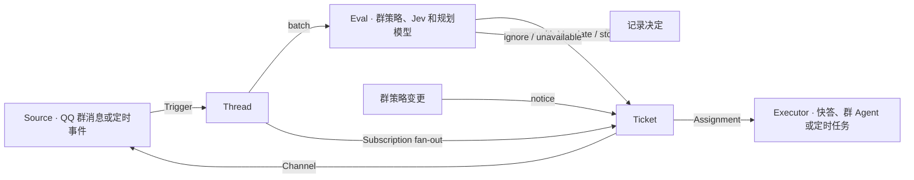

# 群间 · QQ SuperAgent

QQ SuperAgent 接收群聊、准备上下文、规划任务，并根据执行报告组织回复。简短文字交给快答模型，查资料、处理文件和使用技能交给群 Agent。两者都在同一个 Ticket 中执行。默认管理面板只监听本机。

## 一条群消息怎样变成回复



| 环节 | QQ 适配器的职责 |
| --- | --- |
| Source 和 Thread | 按群接收消息，合并 QQ 对同一条发言的重复推送。明确引用可以指回已有 Thread。未引用的发言保留自己的消息标识。 |
| Eval | 群策略决定是否进入判断。启用 Jev 后，它独立判断是否接话、难度和是否记忆。规划模型给执行者说明目标、素材和交付物。最近最多 20 条群消息按发言人、时间、@ 和引用排列，同时带最多 3 张相关记忆卡。 |
| Ticket 和 Assignment | 接受请求时保存授权依据并分派执行者。已订阅 Thread 的人类追问交回原 Ticket。明确叫停可以终止当前任务。群策略变更会通知受影响的任务，工具按当前配置检查权限。 |
| Executor | 快答可以在同一 Ticket 转交负责模型。群 Agent 自行选技能、工具和执行顺序。关闭代码执行的群使用只调用已开放产品工具的 Agent。定时提醒使用保存的文本，记忆归档静默写入本群数据。 |
| Report 和 Channel | 按本轮执行报告生成群回复。文字或已取得的成品进入持久化发送队列。部分交付会保留进度和失败原因；运行完成、排队投递与 QQ 接受可以分别核对。 |

例如群友要求按已安装的短剧技能做 30 秒短片，规划者给出参考人像、总时长、技能和最终交付要求，并摘录群友本条消息中明确委托执行的原话。群 Agent 读取技能，自行拆分角色、场景、道具、分镜首帧和镜头，按需要调用生图、生视频、语音及剪辑工具。每项生成使用稳定的作品编号，中断后可沿用已登记的供应商任务。如果执行者只交了方案，交付目录仍为空，而且没有媒体生成提交记录，执行者会在原会话核对一次尚缺的工作。

多步骤成品附有来自本次委托的验收条件。执行者在原会话检查最终文件；例如要求配乐时，核对配乐是否实际进入对应片段。核对期间可以用已有素材重新剪辑，网关停止接受新的生成订单。缺项仍然存在时，报告记录为部分交付。

流程和术语见上游的[领域模型](vendor/superagent/docs/001-domain.md)和[架构说明](vendor/superagent/docs/007-architecture.md)。

## 新机器首次启动

首次安装需要 Git、可运行 Linux 容器的 Docker Engine（Windows 可用 Docker Desktop）和支持 `additional_contexts` 的 Docker Compose。镜像构建会下载 Node、Python、系统包和 Harness 依赖。宿主机只需能运行 Git 和 Docker。迁移脚本在 Windows 使用 Git 自带的 **Git Bash**，Linux 使用 Bash。

```sh
git clone --recurse-submodules git@github.com:zard110/qq-superagent.git
cd qq-superagent
git submodule status
docker compose -p qq-superagent config --quiet
docker compose -p qq-superagent up --build -d
docker compose -p qq-superagent ps -a
docker compose -p qq-superagent exec app cat /state/admin-token
```

私有仓库需要新机器有对应的 GitHub 访问权限。若使用 HTTPS，可用 `https://github.com/zard110/qq-superagent.git` 克隆。已经克隆的仓库执行 `git submodule update --init --recursive` 即可补齐固定版本的 SuperAgent 内核。

打开 [本机管理面板](http://127.0.0.1:8797/)，用上一步显示的令牌登录。Compose 正常启动后，`app`、`runner` 运行中，`browser` 显示 `healthy`；`sandbox` 和 `harness` 是供 Runner 按需使用的镜像，其初始化容器显示 `Exited (0)` 属于正常状态。服务器可通过 SSH 转发面板端口，在自己的电脑执行 `ssh -L 8797:127.0.0.1:8797 用户名@服务器`。

首次使用在面板保存 QQ App ID 和 Client Secret。使用 OpenAI 或兼容接口时，在「模型供应商」设置 API 基址（官方为 https://api.openai.com/v1）、模型、Key 和可选思考强度，然后在「接入与模型」将主模型设为 OpenAI / 兼容接口。子 Agent 可跟随主模型，视觉需选择支持图像输入的模型。DeepSeek 专用搜索、语音等工具另需其官方密钥。群友消息到达后，会自动识别群 OpenID。主模型、跟随主模型的子 Agent、移动浏览器、网页读图、视频抽帧与转写、群历史和 Harness 续办均已接入。生成图片需另配支持的供应商，相应平台能力和费用取决于账号。可在仓库根目录的 `.env` 覆盖 `PANEL_PORT` 和 `ADMIN_TOKEN`。若指定了 `ADMIN_TOKEN`，登录时直接使用该值。

## 把现有机器人迁到另一台机器

迁移保留两类 Docker 卷。应用卷 `qq-superagent_state` 保存 SQLite、供应商配置、QQ 凭据、管理员令牌、群历史、Ticket、投递记录和已交付的附件。每个 `qq-superagent-group-<群摘要>-work` 卷保存该群的 Harness 会话、草稿、技能和工具。下面统一使用现有部署的项目名 `qq-superagent`。如果原部署另有项目名，在两台机器的 Git Bash 或 Bash 中都先执行 `export COMPOSE_PROJECT_NAME=原项目名`，并将示例中的 `-p qq-superagent` 替换为相同项目名。

### 1. 旧机器停写并备份

在项目目录执行。先在面板确认正在进行的任务已结束，再停止 QQ 接入、Runner 和按需启动的群容器。备份目录选在仓库外，名称须尚未存在。

```bash
docker compose -p qq-superagent stop app runner
docker ps -q --filter "label=qq.group.project=${COMPOSE_PROJECT_NAME:-qq-superagent}" |
  while read -r id; do docker stop "$id" || exit 1; done
bash scripts/migrate.sh backup ../qq-migration
```

将整个 `qq-migration` 目录通过可信渠道复制到新机器，包括 `REVISION`、`SHA256SUMS` 和全部 `.tar.gz`。这些压缩包包含密钥和群聊内容，请保存在私人位置。若部署使用了 `.env` 或宿主机环境变量，请私下复制或重新设置相同的覆盖值。切换期间保持旧机 QQ 服务停止，避免两台机器同时登录同一机器人。

### 2. 新机器还原后再启动

将备份放在仓库的同级目录。在一台有 Git、Docker 和 Compose 的新机器上执行以下命令。还原前保持目标卷为空；脚本会核对源码提交、卷名和 SHA-256，发现已有数据会停止。群工作区若安装了本机编译的工具，建议迁往相同 CPU 架构，跨架构时需重新安装相应工具。

```bash
git clone --recurse-submodules git@github.com:zard110/qq-superagent.git
cd qq-superagent
git checkout "$(cat ../qq-migration/REVISION)"
git submodule update --init --recursive
docker compose -p qq-superagent build
bash scripts/migrate.sh restore ../qq-migration
docker compose -p qq-superagent up -d
docker compose -p qq-superagent ps -a
```

### 3. 验证和回退

- 用原管理员令牌登录面板，确认 QQ 显示“已连接”，旧群、人格、任务记录和供应商设置都能看到。若使用自动生成的令牌，可在新机执行 `docker compose -p qq-superagent exec app cat /state/admin-token`。
- 在能力测试中读取一条带图的分享页，查看实际分析的图片。再从原 QQ 群引用一条历史回复追问，确认机器人接收、检索及投递正常。定时提醒和任务恢复会随应用启动，默认使用北京时间。
- 若需退回旧机，先在新机执行 `docker compose -p qq-superagent stop app runner` 并停止群容器，再在旧机执行 `docker compose -p qq-superagent up -d`。旧卷可恢复到切换前的状态，新机切换后的消息和变更需另行保存。保留两端的卷和备份直至验收完成。

## 群工作区与会话

自然聊天模式支持不带 @ 的交办和续办，例如“把刚刚的剧本整理成完整版”。路由确认任务后直接分派给本群工作区；主动插话的冷却时间仅影响普通讨论。群友引用回复问“什么意思”时，路由优先读取 QQ 事件附带的引文，再查询本群消息索引。

Compose 部署默认启用 DeepSeek Harness worker。主 Agent 负责判断用户在追问、修改作品、另做一版，还是提出了新任务。QQ 引用优先定位原素材，路由同时考虑发言人、候选任务、最近结果和待澄清的问题。无法定位时在群里询问。同一个群可以并存多个 Ticket，续办恢复对应的 SDK 会话，新任务有自己的目录和输入文件。这个目录用于整理任务；可以运行命令的同群成员共享该群工作卷。

每群按需启动一个容器，并复用已安装的工具。每群串行执行，同一部署最多运行两个群沙箱，其他任务排队。空闲约 15 分钟后停机，重启自动挂载本群卷。七天无活动的任务清理中间文件，保留会话和已保存到应用数据卷的交付物。备份时也应保存 `<项目名>-group-<群摘要>-work` 数据卷。

Worker 可以用 shell、Python、FFmpeg 自己组合处理步骤，通过 pip、npm 或 `qq-tool install-deb 包名` 补充工具。Debian 包从签名仓库下载，解包到群目录，需要 root、系统服务或安装脚本的软件须预装进镜像。模型请求使用本轮短期凭证，由应用转发；搜索和网页阅读经 `qq-tool` 调用群内已启用的产品能力。群沙箱只连本群内部网络。包仓库 HTTPS 经过专用代理。单次输入合计上限为 32 MiB，支持图片、音频、视频及 UTF-8 Markdown、文本附件。搜集照片时最多交付三张带原帖来源的图片。模型调用按实际使用计费，后台运行期间可在面板查看调用次数。八分钟无进展会触发一次恢复，继续使用原 Ticket 的目录和会话。

在“能力测试”选择“Harness 群沙箱”，可上传素材和复用测试会话。面板测试使用独立工作区，不向 QQ 发消息。“运行”中可以查看 QQ 请求选中的任务、路由理由和已执行工具。更新时，已有旧格式请求使用原执行路径收尾，新收到的消息使用上图流程。

## 首次接入与演示

1. 在 **模型供应商** 保存 DeepSeek 官方 API Key，再到 **接入与模型** 配置 QQ App ID 和 Client Secret。主模型默认 `deepseek-flash`。子 Agent 默认跟随主模型，也可指定 Flash 或 V4 Pro。图像理解默认 Flash。
2. 网页搜索与阅读使用 DeepSeek 的独立 Search / Fetch 接口，按官方工具 API 计费。未填写密钥时，网页读取的自动模式使用本机读取。OCR 可提取图片和 PDF 原文，ASR 对视频音轨按 30 秒分段转写，TTS 可把明确要求朗读的内容生成 WAV 群语音。**能力测试** 可单独测试主模型、子 Agent、搜索、网页阅读、OCR、视觉问答及语音合成。生图默认关闭，已有的生成供应商可通过“沿用已保存的供应商”继续使用。[DeepSeek 官方接口说明](https://api-docs.deepseek.com/zh-cn/news/news261113/) · [Search / Fetch 计费](https://api-docs.deepseek.com/zh-cn/guides/search/#计费)
3. 在 **群与人格** 中选择群策略和回复风格。支持克制参与、自然聊天和触发词。代码执行与主动投递按群开启。管理员可在 **定时提醒** 设置单次、每日或每周提醒，也可在群内 @ 明确指定时间。
4. 在测试群引用一张海报说“报名截止哪天？照这个风格做成横版”，随后引用作品说“改成蓝色”；引用包含说话声的视频询问预算和时间点；引用一段合并记录询问最终方案；引用知乎卡片要求总结原文并查证。独立提问可以用“搜一下今天的官方公告”，再追问“有官方来源吗？”。
5. 在 **运行** 查看每次请求的 Ticket、调用来源和投递状态。超过 QQ 被动回复窗口、主动发送不可用时，原请求者可在本群 @ 说“领取结果”。分享页使用移动浏览器。需要登录、附件过期或播放器没有可读取的媒体时，回复说明实际可读范围。视频默认分析最多 10 分钟、32 MiB，每段最多 12 张带时间点的抽样画面以及完整音轨。画面时间点是抽样定位，口述时间使用转写片段。

## 每日群记忆

每天北京时间 01:00，后台使用主模型整理前一天本群已收到的消息，写入应用卷 `/state/memory/<群标识哈希>/YYYY-MM-DD.md`。文件区分决定、待办、分歧、建议和话题，并保留原消息 ID 和时间。首次从昨天开始；空白日跳过，停机漏掉的日期恢复后依次补齐。模型失败会保留已完成的分段，稍后重试，群内不会收到日报。

日常路由和答复最多带 3 张相关卡片。Jev 能将明确设定即时保存，待核实内容先进入候选。每日归档按来源合并更正和分歧，更早资料可按日期、关键词检索并回查原话。在“运行 → 每日群记忆”查看状态和消息数，在“群与人格”关闭“检索群历史和每日记忆”可停用该群归档及记忆读取。迁移应用数据卷会同时迁移记忆文件和索引。

## 能力与数据

网页读取默认先调用 Compose 中的 browser 服务，以 Chromium 移动设备模式加载原链接并执行页面脚本。浏览器默认加载图片与视频，使用独立容器和北京时间。读取网页时，会自动分析小红书原帖图集；普通网页默认取正文前六张配图及前两个视频。浏览器达到了读取时间或数据量边界时，任务记录会列出实际读到的图序。图片由 Chromium 解码；公开的视频文件交给沙箱抽帧并按配置转写。只有流式播放器时可提取已经显示的画面。群禁用视觉能力时只保留网页资料。直读无正文时再尝试配置的 Fetch；分享卡片缺少直链时先按标题定位原文。面板调用记录标注实际读取方式和失败原因。

群成员列表返回 11253 时，表示机器人应用尚未获得该接口白名单。需通过 QQ 官方机器人反馈助手联系平台运营，申请当前 AppID 的 `GET /v2/groups/{group_openid}/members` 和成员详情接口权限。授权后在群里说“刷新群成员列表”重新拉取；授权前从消息发送者和被 @ 的对象积累本群身份缓存。

Docker 服务与临时沙箱默认使用北京时间（Asia/Shanghai）。群历史按北京时间筛选，定时提醒也按北京时间输入与显示。SQLite 以 UTC 保存时间戳。

音频剪辑支持“截取上面的音乐，从 1:35 后面开始”：关联本群最近的音乐卡片，解析公开音源，由群工作区用工具处理，或由兼容执行器在离线 Docker 中用 FFmpeg 裁剪，再通过 QQ 语音上传返回 MP3。无法取得音源、只取得试听片段或剪辑范围越界时返回实际失败原因；不会绕过登录或付费播放限制。也可直接引用群音频附件。

沙箱 `runCode` 可接收本群素材作为输入文件，通过 Python/subprocess 调用预装的 ffmpeg/ffprobe，并导出一项图片、音频或 MP4 作品。`packages` 支持按需获取 PyPI 纯 Python wheel（可指定 `包名==版本`，依赖需一并列出），校验摘要后在该次离线任务中安装，结果记录实际版本；含本地编译依赖的工具由部署者加入镜像。无宿主目录或密钥挂载。新群默认可执行，已有明确关闭设置继续生效，面板“群与人格”可控制代码、音源及剪辑能力。

机器人根据 QQ 推送的事件积累群历史。可以问“今天谁发过言”“这个群有多少人”“能收到未 @ 的消息吗”。成员名单需要 QQ 平台单独授权。机器人会分别查询留存记录和 QQ 群资料；之前的讨论可以转发合并聊天记录给机器人。

`app/capabilities.mjs` 中的能力注册表由群 Agent、工具执行器和面板共用。适配器声明工具参数、支持的媒体类型、供应商和执行函数。通过 `register(adapter)` 可以增加能力或覆盖同名实现；执行上下文携带当前群、消息、角色和任务调用标识。返回值包含状态、来源及结构化数据。QQ 下载地址只保存在服务端，模型用群作用域的素材句柄取图。群内记忆仅覆盖机器人已收到的消息。

SQLite 同时保存 Engine 事务、工具调用记录、待处理请求、QQ 连接游标和出站消息。付费生成先登记提交意图，再保存供应商任务 ID 和查询地址；中断后按原任务查询。提交应答不确定时保留记录并提示核对。定时器按触发时刻去重。

`app/core.mjs` 是引入内核的唯一入口。固定版本为 `8c32a9dc5d72c033816c6a8110b37f40cf94fba4`，保留上游 MIT 许可。构建仅打包上游 `src/core`。群内规划与交付入口为 `app/group-runtime.mjs`，通用子任务使用固定的官方 CLI 和 SDK `0.2.2-rc.5`，默认跟随主模型。

## 本地开发与验证

需要 Node.js 24.9+。以下命令在不提供 QQ 和模型凭据的情况下即可运行。原生模式默认端口 8787，配置 `PORT` 可改变端口。原生运行视频和代码能力仍需配置可达的 `RUNNER_URL`，默认 Compose 会连接内部 Runner。

```sh
npm ci
npm test
npm start
```

自动化用例使用官方事件形状、真实内核、真实 SQLite 和本地测试供应商。安装 Python 和 FFmpeg 后，可执行 `python tests/video_worker.py`，验证真实抽帧和音轨提取。真实 QQ 账号订阅、具体分享卡片正文、选定模型的判断质量和收费接口需要用自己的测试群联调。

使用管理员 Bearer 令牌可向 `POST /api/replay` 提交 `{"t":"GROUP_AT_MESSAGE_CREATE","d":{...}}` 回放事件。仅未配置 QQ 账号的实例接受回放。回放仍会使用已配置的模型及生成服务。

[SuperAgent 上游](https://github.com/deepseek-ai/dsh-superagent-prototype) · [QQ 官方接口](https://bot.q.qq.com/wiki/develop/api-v2/)
